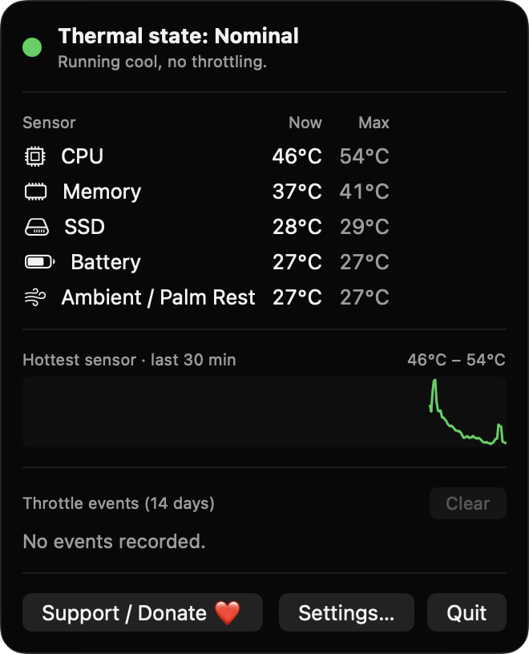
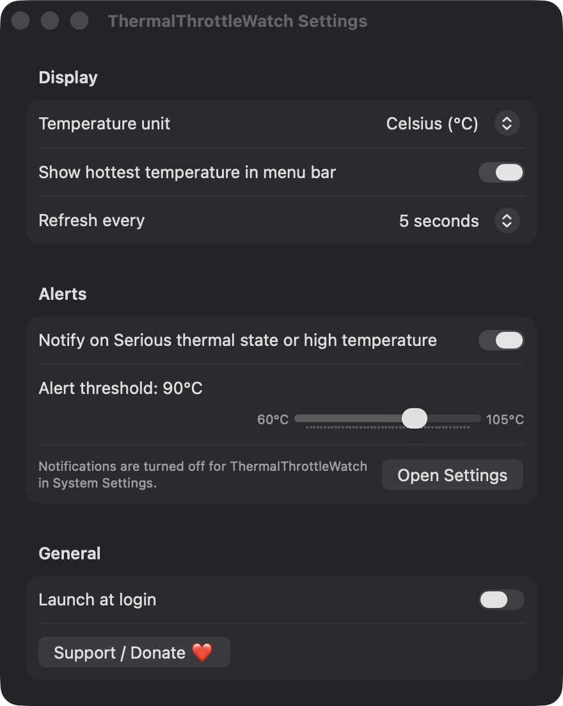

# ThermalThrottleWatch

**🌐 Website:** [turhe123.github.io/thermal-throttle-watch](https://turhe123.github.io/thermal-throttle-watch/)

See your Mac's thermal pressure and sensor temperatures in the menu bar and get warned before it throttles.

> 🆓 A free, open-source **TG Pro alternative** for macOS 14+. Native Swift, no accounts, no subscriptions, MIT licensed.


## Why

ThermalThrottleWatch is a free, open-source, 100% native, backend-free alternative to paid utilities in the *System Monitoring* category. It was inspired by TG Pro ($10 one-time), which does a lot more, including fan control. This app is deliberately read-only and focuses on one question: is my Mac under thermal stress right now? There are no accounts, no servers and no analytics. Everything runs on your Mac.

## Features

- **Menu bar readout:** a thermometer icon tinted by the system thermal state (Nominal, Fair, Serious, Critical), with an optional hottest-sensor temperature next to it.
- **Thermal state header:** the popover shows the current state in words, with a short explanation.
- **Sensor list:** current and peak (since launch) values for CPU, GPU, Memory, SSD, Battery and Ambient / Palm Rest. Only sensors that answer with a plausible value (10–120 °C) on your Mac are shown.
- **30-minute sparkline:** a trend line for the hottest sensor, drawn with a SwiftUI `Path`.
- **Alerts:** a notification when the thermal state reaches Serious or the hottest sensor passes your threshold (60–105 °C, adjustable), and another when it recovers.
- **Alert hygiene:** readings are smoothed with a 3-sample moving average, recovery needs a 3 °C drop below the limit, and the same condition notifies at most once every 5 minutes.
- **Throttle event log:** start time and duration of each episode, kept for 14 days as JSON in Application Support, with a Clear button.
- **Settings:** Celsius or Fahrenheit, show or hide the menu bar number, refresh every 2, 5 or 10 seconds, notifications on or off, launch at login.
- **Graceful fallback:** if the SMC can't be opened or no sensors are readable, the app shows the system thermal state only and says so in the popover.

## Screenshots

<p align="center"></p>

<p align="center"><em>The menu bar popover shows the system thermal state, current and peak temperatures for each readable sensor, a 30-minute trend of the hottest sensor, and the throttle event log.</em></p>

<p align="center"></p>

<p align="center"><em>Settings let you pick Celsius or Fahrenheit, show the temperature in the menu bar, set the refresh rate and alert threshold, and launch at login.</em></p>

## Install

1. Download `ThermalThrottleWatch-macOS.zip` from the [latest release](https://github.com/turhe123/thermal-throttle-watch/releases/latest).
2. Unzip it and move `ThermalThrottleWatch.app` to `/Applications`.
3. The app is open source and not notarized, so macOS will quarantine it. Run:

   ```bash
   xattr -cr /Applications/ThermalThrottleWatch.app
   ```

4. Right-click the app → **Open** the first time.

## Build from source

Requires macOS 14+ and Xcode with Swift 5.9 or later.

```bash
brew install xcodegen
xcodegen generate
xcodebuild -project ThermalThrottleWatch.xcodeproj -scheme ThermalThrottleWatch -configuration Release -derivedDataPath ./build build
```

The app is written to `build/Build/Products/Release/ThermalThrottleWatch.app`.

## Permissions

ThermalThrottleWatch asks for very little:

- **Notifications:** requested (alert and sound) so it can warn you about throttling and recovery. Optional; turn it off in Settings, or in System Settings → Notifications.
- **Login item:** only if you enable "Launch at login" (uses `SMAppService`).
- **Accessibility, Screen Recording, Microphone, Camera, Location:** *not* requested. The code uses none of them.

Temperatures come from the AppleSMC service via IOKit, plus the AppleSmartBattery registry entry for battery temperature. These reads are not a macOS permission, but they only work in a **non-sandboxed** build, which is how this app is built. In a sandboxed build the app falls back to the system thermal state only.

Sensor keys are probed per chip family. Support varies across Intel and Apple Silicon generations, so some Macs will show fewer sensors than others.

## Built with AI

ThermalThrottleWatch was written by [Claude Code](https://claude.com/claude-code) inside an automated pipeline, from a plain-English spec. No code, binaries or assets from any commercial app were used; it is a clean-room reimplementation of a feature set, not a copy.

What that means in practice:

- The full source is in this repo under the MIT license. Read it before you run it.
- No network calls, no analytics, no third-party dependencies. Only Apple frameworks.
- Ad-hoc signed and not notarized, which is why Gatekeeper warns on first launch.
- It has had less human review than a hand-written app. Bug reports and pull requests are welcome.

## Support ❤️

If this app is useful to you, you can support its development:

[Support Or (Leo) Davidai ❤️](https://ko-fi.com/leodavidai)

The app also has a "Support / Donate ❤️" button in the popover and in Settings.

## More free Mac apps

ThermalThrottleWatch is one of [60 free, open-source Mac utilities](https://github.com/turhe123/mac-apps) built the same way: native Swift, no accounts, no telemetry. Browse the full gallery at [turhe123.github.io/mac-apps](https://turhe123.github.io/mac-apps/).

## License

MIT © Or Davidai Bachar
